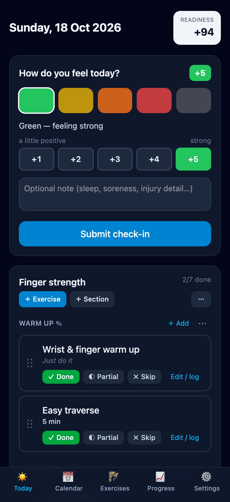
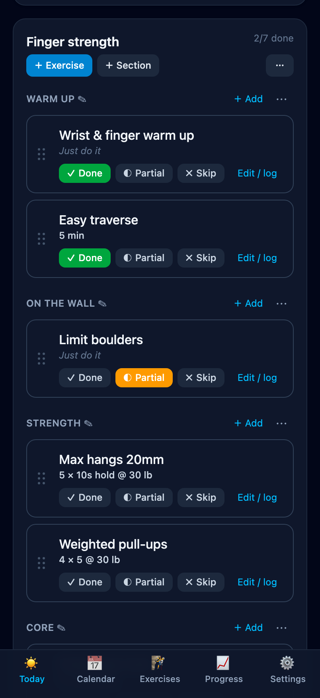
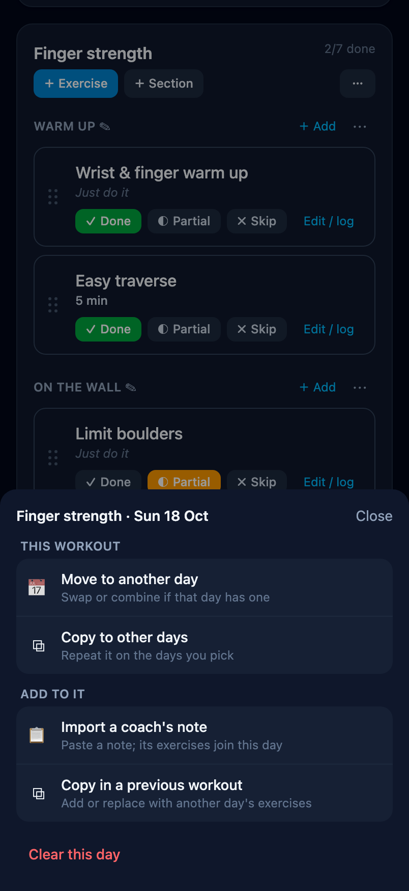
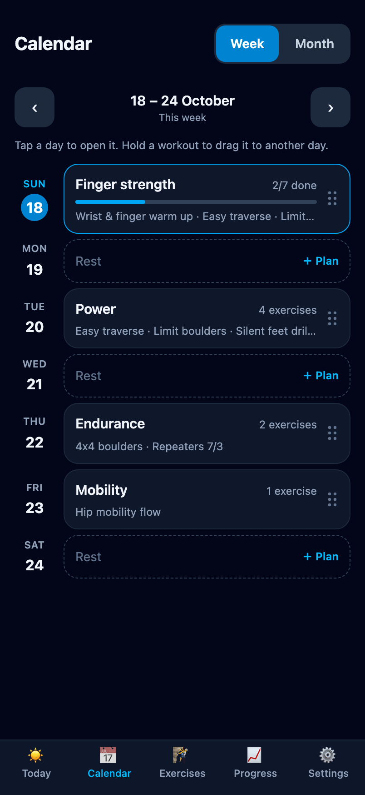
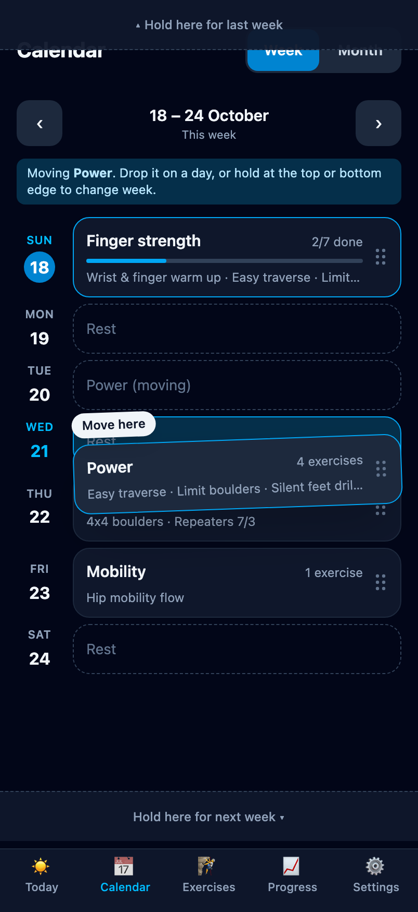
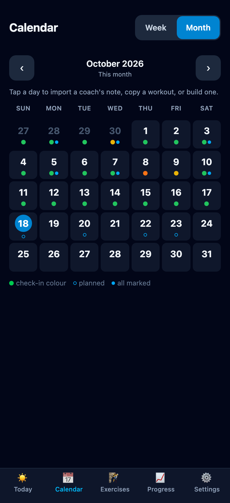
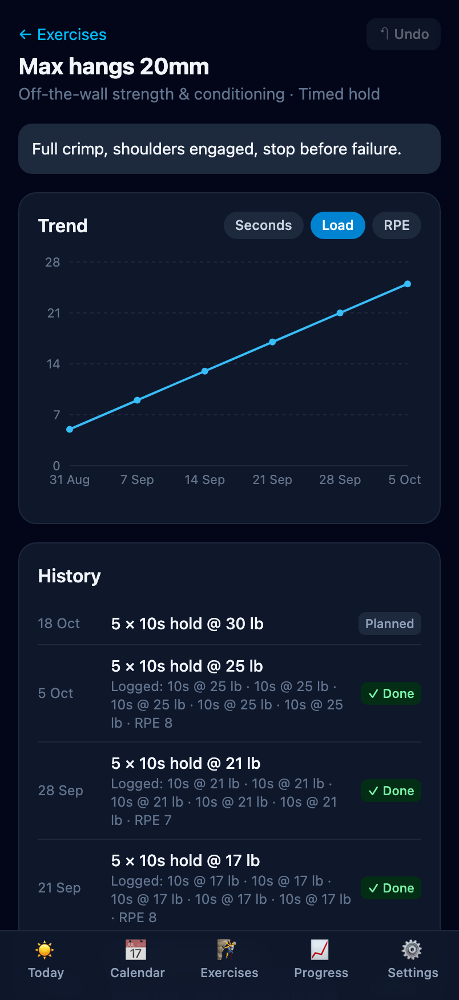
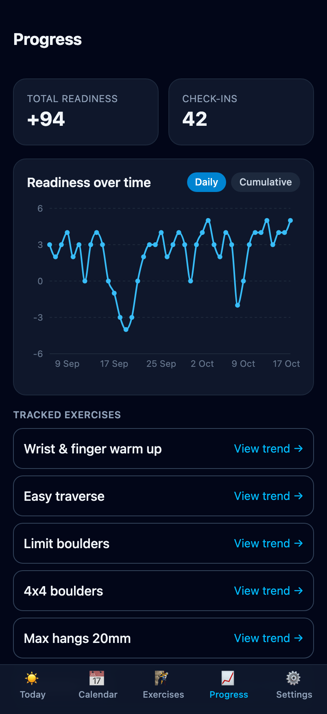
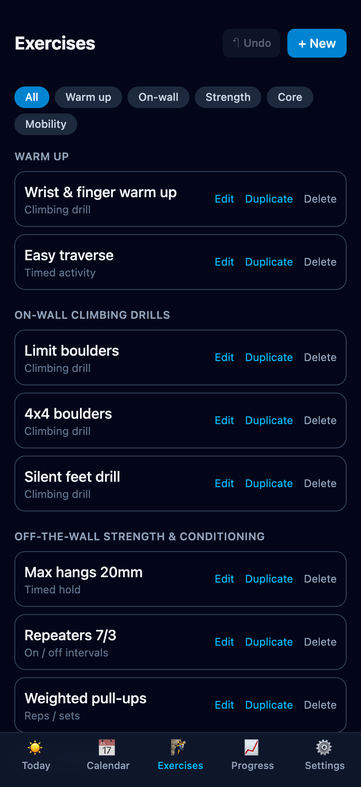

# Break Your Plateau

My personal bouldering training tracker — a mobile-first web app for planning workouts, logging them, and watching progress over time:

- **Daily readiness check-in** — Green / Yellow / Orange / Red / Black, graded to a points score.
- **Calendar** for planning: a week view where you hold a workout and drag it to another day (or another week), and a month view. On any day, import a coach's note, copy a previous workout, or build one exercise by exercise.
- **Reschedule** a workout from its day: **⋯ → Move to another day**, then pick a date — if that day already has a workout, swap the two or combine them. Marks and logged numbers move with it, and every change can be undone.
- **Exercises are building blocks** (name, category — _warm up_, _on-wall drills_, _off-the-wall strength & conditioning_, _core_, _mobility_ — cues, media). Sets/reps/time/weight live on each **workout**, so the same exercise progresses week to week (e.g. Shrugs 1×5 → 1×7). Adding an exercise pre-fills last time's numbers.
- **Workouts** follow the coach's structure — sections (e.g. Pre Climbing / Climbing / Post Climbing), groups (e.g. TFCC warm up), and focus cues — with complete / partial / skipped marks.
- **Time-based exercises** (timed holds, "max reps in 10 s", timed activities), loads in lb or kg, and no-target items (like climbing drills) that are just a checkbox.
- **Reference media** (image/video URL) per exercise to confirm form.
- **Trend charts** per exercise and a readiness-over-time view.
- **Import a coach's note** — an LLM turns it into a workout on the days you pick, matching exercises you already have so their history continues (optional; choose **Claude (Anthropic)**, **ChatGPT (OpenAI)** or **Gemini (Google)** and use your own API key — Gemini has a free tier).

<table>
  <tr>
    <td align="center"><br><sub><b>Today</b> — how do you feel?</sub></td>
    <td align="center"><br><sub><b>Workout</b> — mark each exercise</sub></td>
    <td align="center"><br><sub><b>⋯ menu</b> — move, copy, import</sub></td>
  </tr>
  <tr>
    <td align="center"><br><sub><b>Week</b> — the plan at a glance</sub></td>
    <td align="center"><br><sub><b>Drag</b> — hold a workout to move it</sub></td>
    <td align="center"><br><sub><b>Month</b> — check-ins and workouts</sub></td>
  </tr>
  <tr>
    <td align="center"><br><sub><b>Exercise trend</b> — load over time</sub></td>
    <td align="center"><br><sub><b>Progress</b> — readiness over time</sub></td>
    <td align="center"><br><sub><b>Exercises</b> — your building blocks</sub></td>
  </tr>
</table>

<sub>Screenshots use demo data. To retake them after UI changes: <code>npm run build && npx vite preview --port 4795</code>, then <code>node scripts/screenshots.mjs http://localhost:4795 docs/screenshots</code> (needs Google Chrome).</sub>

Your data is saved on the device you're using. Sign in to **Cloud sync** (Supabase, see below) and it's kept in your own Supabase project so every device has it; without sync, use **Settings → Export JSON** to back up or move data between devices.

## Develop

```bash
npm install
npm run dev      # http://localhost:5173
npm run build    # type-check + production build
npm run preview  # serve the production build
```

On your phone, use the browser's "Add to Home Screen" to open it like an app.

## AI note parsing

In **Settings → AI note parsing**, pick a provider — **Claude (Anthropic)**, **ChatGPT (OpenAI)** or **Gemini (Google)** — enter that provider's API key, and choose a model. API use is billed separately from ChatGPT/Claude chat subscriptions; **Gemini** has a free tier (get a key at [aistudio.google.com](https://aistudio.google.com), no card needed — on the free tier Google may use what you send to improve its products, and requests are rate-limited per minute and per day). Keys are stored only in your browser; calls go directly from your device to the chosen provider. Then tap a day in the **Calendar** → **Import coach's note** (the import dialog also lets you put the workout on several days at once). Works fully without a key via manual entry.

### Sample coach note (for testing the parser)

```
Tuesday session — power

Warm up: 5 min easy traverse, then wrist + shoulder mobility flow 3 min.

On the wall:
- 4x4 boulders at V3, full rest between sets
- Silent feet drill, 3 routes

Strength:
- Max hangs on 20mm edge: 5 x 10s, full crimp
- Weighted pull-ups 4 x 5 @ +15kg
- Campus ladders 3 sets

Core:
- Front lever progression 4 x 12s hold
- Hanging leg raises 3 x 10

Finish with 10 min stretching.
```

Expected result: one workout with sections in the note's order — a warm-up
(traverse → `duration` 5 min, mobility flow → `duration` 3 min), "On the wall"
(4x4 boulders, silent feet drill), "Strength" (max hangs → `hold` 5 × 10s,
weighted pull-ups → `reps` 4 × 5 @ 15 kg, campus ladders → 3 sets), "Core"
(front lever → `hold` 4 × 12s, leg raises → `reps` 3 × 10) and stretching.
You review each exercise (matched to an existing one, or new), then pick the
day(s) it goes on.

## Cloud sync (Supabase) — optional

Syncs check-ins, exercises and workouts across devices. The app keeps working without a connection and syncs in the background (after edits, on startup, when the app regains focus or comes back online). Conflicts resolve last-write-wins per record. AI API keys stay in the browser unless you turn on **Settings → Save API keys to my account**, which stores your provider, models and keys in your Supabase project (readable only when signed in as you) and syncs them to your other devices. Turning it off removes them from the server.

One-time setup:

1. Create a project at [supabase.com](https://supabase.com) (free tier is fine).
2. **SQL Editor → New query**, paste the contents of [`supabase/schema.sql`](supabase/schema.sql), **Run**. This creates the `records` table with row-level security (each user can only see their own rows).
3. **Authentication → Sign In / Providers → Email**: turn **Confirm email** off. This lets you sign in with an email + password immediately, with no email sent.
4. **Project Settings → API**: copy the project URL and the `anon` public key into `.env.local` (see `.env.example`):
   ```
   VITE_SUPABASE_URL=https://xxxx.supabase.co
   VITE_SUPABASE_ANON_KEY=...
   ```
5. Restart `npm run dev`, open **Settings → Cloud sync**, enter your email and a password, and tap **Create account**. On your other devices, **Sign in** with the same email and password.
6. Optional but recommended: once your account exists, turn off **Allow new users to sign up** (same Email settings page) so nobody else can create accounts on your project.

Prefer a passwordless **Email code**? It needs the Magic Link email template to include `{{ .Token }}` (Authentication → Email Templates). Supabase may restrict template editing unless custom SMTP is configured; if so, use the password option instead. The built-in email sender also has a very low hourly limit.

If you set up sync before the API-key option existed, re-run `supabase/schema.sql` (it's safe to re-run) to add the `user_settings` table.

For a deployed build, set the same two `VITE_` variables in your host's environment.
